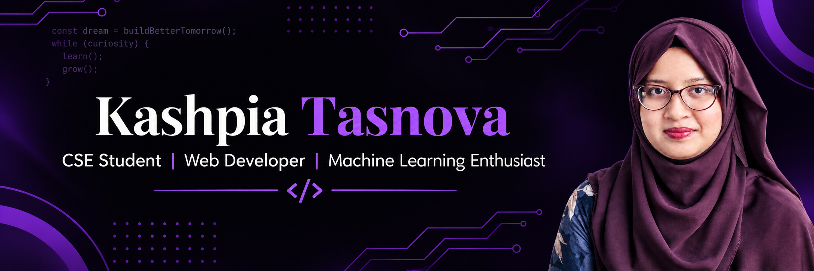

 

  

<h1 align="center">Hi 👋, I'm Kashpia Tasnova</h1>

<h3 align="center">
  Computer Science & Engineering Student | Web Developer | Machine Learning Enthusiast
</h3>

  📍 Chittagong, Bangladesh

  
  

---

## 👩‍💻 About Me

I'm a passionate **Computer Science and Engineering student** with a strong interest in **Web Development, Machine Learning, and Artificial Intelligence**.

I enjoy developing modern, responsive, and user-friendly web applications and exploring intelligent solutions through machine learning. I love learning new technologies, solving problems, and turning creative ideas into practical applications.

- 🎓 Pursuing a degree in Computer Science and Engineering.
- 💻 Interested in Full-Stack Web Development.
- 🌱 Currently learning **PHP, Laravel, Machine Learning, Deep Learning, and NLP**.
- 🚀 Currently developing **StudioSpace**, a peer-to-peer creative workspace and production studio sharing platform.
- 🤖 Exploring Explainable AI and Deep Learning applications.
- 🎯 Passionate about continuous learning, innovation, and problem-solving.

---

## 🛠️ Skills & Technologies

| **Skills Category** | **Technologies** |
|:---|:---|
| **Programming Languages** |       |
| **Frontend Development** |       |
| **Backend Development** |      |
| **Database** |    |
| **Machine Learning & AI** |        |
| **Tools & Platforms** |       |

---

## 📊 GitHub Statistics

  
  

## 🔥 Contribution Streak

  

## 📈 Contribution Activity

  

---

## 🌐 Connect With Me

  
  
  
  

---

  <i>Building, learning, and growing one project at a time. ✨</i>

